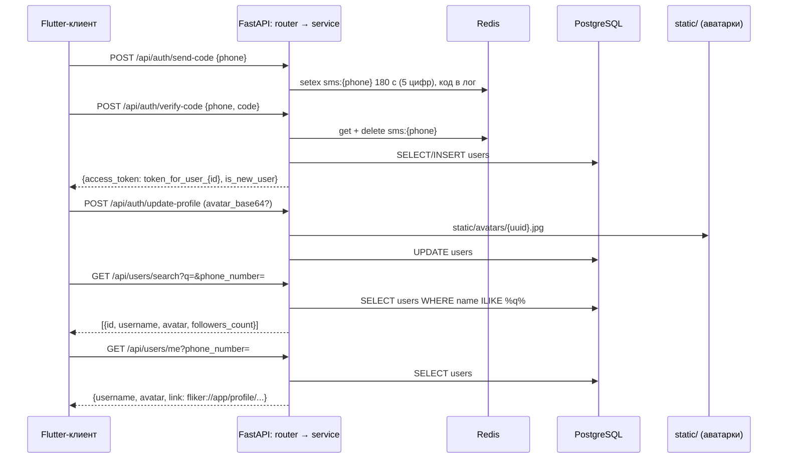

# Архитектура «Фликера»

Карта исходников репозитория: **роль файла** и **публичные сущности**.  
Каталог `flutter/` — полный чек-аут Flutter SDK (инструмент, а не код проекта) и здесь не расписывается. Генерируемые каталоги (`frontend/.dart_tool/`, `frontend/build/`, `__pycache__/`, `.venv/`) править не нужно.

См. также: [README.md](./README.md) · [AGENTS.md](./AGENTS.md)

## 📒 Содержание

- [Общая схема](#-общая-схема)
- [Структура репозитория](#-структура-репозитория)
- [API (FastAPI)](#-api-fastapi)
- [Клиент (Flutter)](#-клиент-flutter)
- [Экспериментальный Go-сервис](#-экспериментальный-go-сервис)
- [Потоки данных](#-потоки-данных)
- [Границы модулей](#-границы-модулей)

## 🗺️ Общая схема



## 📁 Структура репозитория

```
Flicker_NEW/
├── frontend/                      # Flutter-клиент (package frontend)
│   ├── assets/
│   │   ├── icons/                 # SVG/PNG: навигация, QR, логотип, флаг
│   │   └── images/                # onboarding_1..3.jpg, illustration.png
│   ├── lib/
│   │   ├── main.dart              # entry, FlickerApp
│   │   ├── onboarding_screen.dart # онбординг первого запуска
│   │   ├── otp_screen.dart        # ⚠️ легаси: старый OTP (pinput)
│   │   ├── registration_screens.dart  # ⚠️ легаси: старая регистрация
│   │   ├── core/api/              # ApiClient (Dio)
│   │   └── features/              # auth, home, profile (data + ui)
│   ├── test/widget_test.dart      # ⚠️ устарел: ссылается на MyApp
│   └── web/                       # заготовка web-таргета
├── backend/                       # API
│   ├── app/                       # FastAPI: main, api, core, db, schemas, services
│   ├── go_app/                    # эксперимент: Gin-сервис (мок профиля)
│   ├── Dockerfile                 # python:3.11-slim + uvicorn
│   ├── docker-compose.yml         # db + redis + web + caddy
│   ├── Caddyfile                  # api.web-flicker.online → web:8000
│   └── requirements.txt
├── flutter/                       # Flutter SDK (инструмент)
├── .gitattributes                 # LF-нормализация
└── README.md / ARCHITECTURE.md / AGENTS.md
```

## 🧱 API (FastAPI)

Пакеты `app/` не содержат `__init__.py` — это namespace packages; главное — запускать uvicorn из каталога `backend/`, чтобы работал `app.main:app`.

```
backend/app/
├── main.py                  # FastAPI-приложение, lifespan, CORS, /static, роутеры
├── core/config.py           # Settings (pydantic-settings), DATABASE_URL, REDIS_URL
├── db/database.py           # async engine, сессии, Base, redis_client, get_db
├── db/models.py             # User, HiddenRecommendation
├── schemas/auth.py          # PhoneRequest, VerifyRequest, AuthResponse, ProfileUpdateRequest
├── schemas/users.py         # RecommendedUser, HideUserRequest
├── services/auth_service.py # OTP, вход, обновление профиля
└── api/
    ├── auth.py              # /auth/send-code, /verify-code, /update-profile
    └── users.py             # /users/recommendations, /hide-recommendation, /me, /search
```

### app/main.py

Порядок старта: `lifespan` → `Base.metadata.create_all` (без `drop_all`) → приложение с CORS (`*`, credentials) → монтирование `/static` → роутеры `auth` и `users` с префиксом `/api`.

| Сущность | Тип | Назначение |
|----------|-----|------------|
| `lifespan(app)` | asynccontextmanager | Создание таблиц при старте |
| `app` | `FastAPI` | `title="Backend API"`, авто-документация на `/docs` |
| `STATIC_DIR` | str | `backend/static` (от `__file__`), используется при первом mount |
| CORS | middleware | `allow_origins=["*"]`, `allow_credentials=True` — для прода заменить |
| `/static` | `StaticFiles` | Монтируется **дважды**: по `STATIC_DIR` и по относительному `static`; второй mount перекрывает первый |
| Роутер `/api/auth` | `APIRouter` | `send-code`, `verify-code`, `update-profile` |
| Роутер `/api/users` | `APIRouter` | `recommendations`, `hide-recommendation`, `me`, `search` |
| `__main__` | блок | `uvicorn.run(..., port=8000, reload=True)` — только для локального запуска |

### app/core/config.py

| Сущность | Тип | Назначение |
|----------|-----|------------|
| `Settings` | `BaseSettings` | `DB_HOST`, `REDIS_HOST` (из ENV, fallback `127.0.0.1`); `DB_USER`/`DB_PASS`/`DB_NAME` — жёстко `backend_user`/`backend_password`/`backend_db` |
| `DATABASE_URL` | property | `postgresql+asyncpg://backend_user:backend_password@{DB_HOST}:5432/backend_db` — порт зафиксирован |
| `REDIS_URL` | property | `redis://{REDIS_HOST}:6379/0` |
| `settings` | экземпляр | Глобальный синглтон конфигурации |

### app/db/database.py

| Сущность | Тип | Назначение |
|----------|-----|------------|
| `engine` | `AsyncEngine` | `create_async_engine(..., echo=True)` — SQL логируется полностью |
| `AsyncSessionLocal` | `async_sessionmaker` | Фабрика `AsyncSession`, `expire_on_commit=False` |
| `Base` | `DeclarativeBase` | База моделей |
| `redis_client` | `redis.asyncio.Redis` | `from_url`, `decode_responses=True` — используется только для OTP |
| `get_db()` | async dependency | Выдаёт сессию на время запроса |

### app/db/models.py

| Таблица | Ключевые поля |
|---------|---------------|
| `users` | `id` PK, `phone_number` UNIQUE, `created_at`, `name`, `avatar_url`, `interests ARRAY(String)`, `discovery_source` |
| `hidden_recommendations` | `id` PK, `user_id → users.id`, `hidden_user_id → users.id` |

> ⚠️ Колонки `is_new_user` в модели нет, хотя `services/auth_service.py` пытается её присваивать — `update-profile` падает с 500 (см. [README](./README.md)). Колонки `followers_count` тоже нет — поиск подставляет заглушку.

### app/schemas/auth.py

| Сущность | Назначение |
|----------|------------|
| `PhoneRequest` | `phone_number` |
| `VerifyRequest` | `phone_number`, `code` |
| `AuthResponse` | `access_token`, `is_new_user`, `message` |
| `ProfileUpdateRequest` | `phone_number`, `name`, `interests: List[str]`, `discovery_source?`, `avatar_base64?` |

### app/schemas/users.py

| Сущность | Назначение |
|----------|------------|
| `RecommendedUser` | `id`, `username`, `subtitle` («Общие интересы: …»), `avatar` |
| `HideUserRequest` | `hidden_user_id: int` |

### app/services/auth_service.py

| Сущность | Тип | Назначение |
|----------|-----|------------|
| `send_sms_logic(phone_number)` | async func | 5-значный код → Redis `sms:{phone}` на 180 с; код печатается в лог (заглушка SMS-шлюза); лимитов повторной отправки нет |
| `verify_code_and_login(db, phone, code)` | async func → `(token, is_new, msg)` | Сверка и удаление кода в Redis; создание `User` при первом входе; возвращает **фейковый** токен `token_for_user_{id}` |
| `update_user_profile(db, ...)` | async func → bool | Обновляет name/interests/discovery_source/avatar_url; **⚠️ строка `user.is_new_user = False` роняет эндпоинт** |

### app/api/auth.py

| Эндпоинт | Назначение |
|----------|------------|
| `POST /send-code` | `PhoneRequest` → `{"message": "Код отправлен"}` |
| `POST /verify-code` | `response_model=AuthResponse`; неверный код → 400 |
| `POST /update-profile` | Декодирует `avatar_base64` в `static/avatars/{uuid}.jpg` (ошибка → 400); нет пользователя → 404 |

### app/api/users.py

| Эндпоинт | Назначение |
|----------|------------|
| `GET /recommendations?phone_number=` | Пользователи с пересечением хотя бы одного интереса (`interests.overlap`), минус скрытые, `LIMIT 5`; без интересов → `[]`; аватар дополняется до `https://api.web-flicker.online/...`, иначе `i.pravatar.cc` |
| `POST /hide-recommendation?phone_number=` | Вставка в `hidden_recommendations`; нет пользователя → 404 |
| `GET /me?phone_number=` | Инлайн-модель `UserProfile` (`id`, `username`, `avatar`, `link`); username = `name` или `user_{id}`; ссылка `fliker://app/profile/{username}` |
| `GET /search?q=&phone_number=` | `name ILIKE %q%` с исключением себя, `LIMIT 20`; без запроса — `LIMIT 5`; `followers_count` — всегда 24 (заглушка через `getattr`) |

## 📱 Клиент (Flutter)

Пакет называется `frontend` (импорты вида `package:frontend/...`). Дизайн: тёмный фон `#0A0A0A`, акцент `#C7F431`, стекло через `BackdropFilter` + `#1C1C1C` (50%). Палитра повторяется в каждом экране — общая тема пока не вынесена.

```
frontend/lib/
├── main.dart                              # entry: isFirstLaunch → Onboarding | Login
├── onboarding_screen.dart                 # 3 слайда, флаг isFirstLaunch
├── otp_screen.dart                        # ⚠️ легаси (pinput + dio), не подключён
├── registration_screens.dart              # ⚠️ легаси (старый флоу регистрации), не подключён
├── core/
│   └── api/api_client.dart                # Dio-синглтон: baseUrl, таймауты 10 с
└── features/
    ├── auth/
    │   ├── data/auth_repository.dart      # sendCode через ApiClient (пока не используется)
    │   └── ui/
    │       ├── login_screen.dart          # номер → POST /auth/send-code
    │       ├── verify_code_screen.dart    # 5 ячеек кода, таймер 50 с
    │       └── profile_setup_screen.dart  # 3 шага: имя+аватар, интересы, источник
    ├── home/ui/
    │   ├── main_screen.dart               # стеклянная навигация, пустая лента
    │   ├── search_screen.dart             # живой поиск + карточка приглашения
    │   └── qr_screen.dart                 # персональный QR-код
    └── profile/ui/
        └── alien_profile_screen.dart      # макет чужого профиля (мок)
```

### main.dart

| Сущность | Тип | Назначение |
|----------|-----|------------|
| `main()` | entry | `ensureInitialized`, чтение `isFirstLaunch` из `SharedPreferences`, `runApp` |
| `FlickerApp` | StatelessWidget | `MaterialApp` (Material 3, тёмный `#0A0A0A`), `home`: `OnboardingScreen` или `LoginScreen` |

### onboarding_screen.dart

| Сущность | Тип | Назначение |
|----------|-----|------------|
| `OnboardingData` | class | Данные слайда: `imagePath`, `stepNumber`, `stepTag`, `title`, `description` |
| `OnboardingScreen` | StatefulWidget | 3 слайда (`PageView`) с кнопкой «Далее» |
| `_finishOnboarding` | method | `isFirstLaunch=false` → `LoginScreen` |

### core/api/api_client.dart

| Сущность | Тип | Назначение |
|----------|-----|------------|
| `ApiClient` | class | Синглтон поверх `Dio`: `baseUrl = 'https://api.web-flicker.online/api'`, connect/receive timeout 10 с, JSON-заголовки |

### features/auth/

| Файл | Сущность | Тип | Назначение |
|------|----------|-----|------------|
| `data/auth_repository.dart` | `AuthRepository` / `sendCode(phone)` | class / Future\<bool\> | Отправка кода через `ApiClient`; **экранами не используется** (login ходит через `http`) |
| `ui/login_screen.dart` | `LoginScreen` | StatefulWidget | Поле номера с префиксом `+7` и флагом (`ru_flag.svg`), маска `_RussianPhoneFormatter` (пробелы на 3/6/8), кнопка активна при 10 цифрах; `POST /auth/send-code` через `package:http` → `VerifyCodeScreen` |
| `ui/verify_code_screen.dart` | `VerifyCodeScreen` | StatefulWidget | Невидимый `TextField` + 5 ячеек (`VerifyState: typing/loading/error/success`), таймер повторной отправки 50 с; `POST /auth/verify-code`; сохраняет `current_phone`; `is_new_user` → `ProfileSetupScreen`, иначе `MainScreen` |
| `ui/profile_setup_screen.dart` | `ProfileSetupScreen` | StatefulWidget | `PageView` из 3 шагов (прогресс-бар, `PopScope` для «назад»): имя + аватар (`image_picker`, base64), ровно 3 интереса из каталога (`Игры`/`Спорт`/`Оффлайн активности`), источник (`TikTok/Reels`, `Discord-комьюнити`, …); `POST /auth/update-profile` → `MainScreen` |

### features/home/

| Файл | Сущность | Тип | Назначение |
|------|----------|-----|------------|
| `ui/main_screen.dart` | `MainScreen` | StatefulWidget | Шапка (`logo.svg`, `bell.svg`), тело по `_currentIndex`, плавающая стеклянная навигация (blur 10, `#1C1C1C` 50%, 367×64): Главная / Поиск / центральная «+» / Чаты / Профиль; вкладки 0, 3, 4 — заглушки `Text('Экран N')`; пустое состояние ленты с `illustration.png` и кнопкой «Добавить друзей» |
| `ui/search_screen.dart` | `SearchScreen` | StatefulWidget | Поиск с debounce 500 мс → `GET /users/search?q=&phone_number=` (свой номер из `current_phone`); карточка «Пригласите своих друзей» (`fliker://app/profile/invite-friends`) → `QrScreen`; список результатов с «Показать ещё» (статичная кнопка) |
| `ui/qr_screen.dart` | `QrScreen` | StatefulWidget | `GET /users/me?phone_number=` → username/avatar/link; `RepaintBoundary` с `QrDotPainter`; действия: копирование ссылки (`Clipboard`), сохранение (`image_gallery_saver_plus`, имя `Fliker_QR_{username}`), шеринг (`share_plus`); пульс-бейдж «Ссылка скопирована» на `AnimationController` |
| `ui/qr_screen.dart` | `QrDotPainter` | CustomPainter | Точечный QR (`qr`-пакет, коррекция Q): круглые модули, скруглённые «глаза» кастомные, по центру `qr_logo.svg` |

### features/profile/ui/alien_profile_screen.dart

| Сущность | Тип | Назначение |
|----------|-----|------------|
| `AlienProfileScreen` | StatefulWidget | Макет чужого профиля: заглушка загрузки 1 с, моковые данные (`maksim_ph`, 38 друзей), кнопки «Добавить в друзья» / «Написать сообщение», вкладки Публикации/Истории/О себе |
| `_fetchProfileData` | method | Имитация сети (`Future.delayed`); вызов API закомментирован |

### Легаси: otp_screen.dart и registration_screens.dart

`OtpScreen` (pinput, таймер 50 с, dio) и `RegistrationFlow` (3 шага, dio → `/auth/update-profile`) — предыдущая итерация экранов, которые теперь живут в `features/auth/`. Из `main.dart` не вызываются; удаление — отдельная задача (см. [AGENTS.md](./AGENTS.md)).

## 🧪 Экспериментальный Go-сервис

```
backend/go_app/
├── main.go      # Gin: GET /api/users/{id}/profile → моковый UserProfile
└── Dockerfile   # пустой файл-заготовка
```

| Сущность | Назначение |
|----------|------------|
| `UserProfile` | struct: `id`, `username`, `bio`, `friends_count`, `initial` |
| `GetProfile` | Возвращает хардкод-профиль (`maksim_ph`, 38 друзей) — БД не подключается |
| `main` | CORS `*`, группа `/api/users`, порт 8080 (FastAPI — на 8000) |

В `docker-compose.yml` не входит; клиент к нему пока не обращается.

## 🔄 Потоки данных

### Вход по телефону

1. `main.dart` → первый запуск? `OnboardingScreen` : `LoginScreen`.
2. `LoginScreen` шлёт `POST /api/auth/send-code`; сервис кладёт 5-значный код в Redis на 180 с и печатает его в лог.
3. `VerifyCodeScreen` шлёт `POST /api/auth/verify-code`; сервис сверяет код, создаёт `User` при первом входе, отдаёт фейковый токен и `is_new_user`.
4. Клиент сохраняет `current_phone` в `SharedPreferences` и маршрутизирует: новый пользователь → `ProfileSetupScreen`, иначе → `MainScreen`.
5. `ProfileSetupScreen` собирает имя/аватар/интересы/источник и шлёт `POST /api/auth/update-profile` (⚠️ сейчас падает на бэкенде) → `MainScreen`.

### Поиск

1. `SearchScreen` с debounce 500 мс вызывает `GET /api/users/search?q=...&phone_number=...`.
2. Бэкенд ищет `name ILIKE %q%` (без самого себя), до 20 строк.
3. Клиент рисует карточки: аватар (относительный путь дополняется до `https://api.web-flicker.online`), username, «Подписаны 24 человека» (заглушка).

### QR и приглашения

1. `QrScreen` запрашивает `GET /api/users/me?phone_number=...`.
2. Бэкенд отдаёт `link` вида `fliker://app/profile/{username}`.
3. Клиент кодирует ссылку в QR (`QrDotPainter`), позволяет скопировать, сохранить в галерею или отправить через системный шеринг.
4. Deep-link `fliker://...` клиентом ещё не обрабатывается.

### Рекомендации (бэкенд готов, экран не подключён)

1. `GET /api/users/recommendations?phone_number=` находит пользователей с `interests.overlap` текущего, исключает `hidden_recommendations`, берёт до 5.
2. Подпись карточки — «Общие интересы: X, Y» (первые два совпадения).
3. `POST /api/users/hide-recommendation` добавляет пару `(user_id, hidden_user_id)` в чёрный список.

## 🚧 Границы модулей

| Слой | Должен делать | Не должен |
|------|----------------|-----------|
| `core/api/api_client.dart` | Базовый URL, таймауты, единый экземпляр `Dio` | Знать про экраны; сейчас экраны обходят его через `package:http` — так делать не надо |
| `features/*/ui` | UI, локальный state, навигация | Прямой HTTP в обход `ApiClient`, бизнес-логика, хардкод URL и палитры |
| `features/*/data` | Репозитории поверх `ApiClient` | Виджеты и строки интерфейса |
| `app/api/` | HTTP: разбор payload, коды ответов | SQL и бизнес-правила (сейчас SQL-запросы прямо в обработчиках — долг) |
| `app/services/` | Бизнес-логика: OTP, вход, профиль | Формирование HTTP-ответов, знание о FastAPI |
| `app/schemas/` | Pydantic-DTO запросов и ответов | Логика и доступ к БД |
| `app/db/` | Engine, сессии, модели, `get_db` | HTTP и бизнес-логика |
| `go_app/` | Эксперимент с Gin (мок) | Дублировать прод-логику FastAPI |

При добавлении файла или публичной функции — обновите этот документ.
